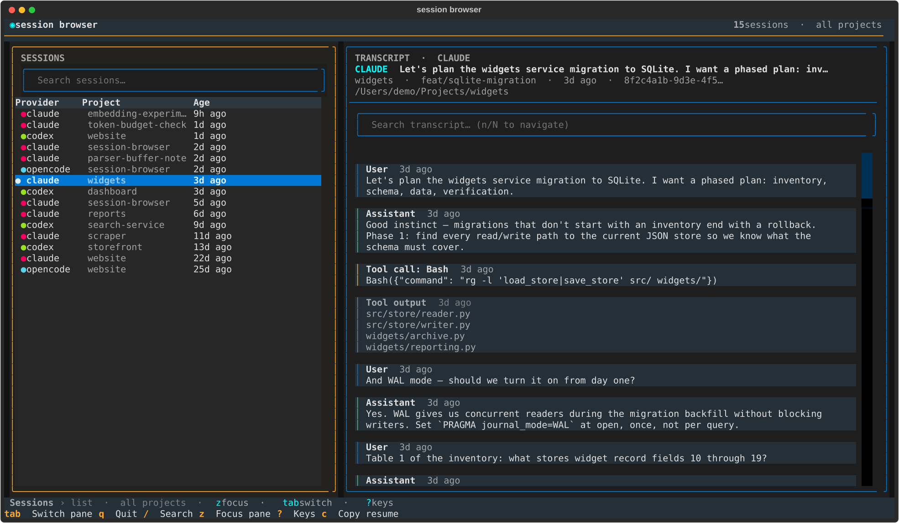
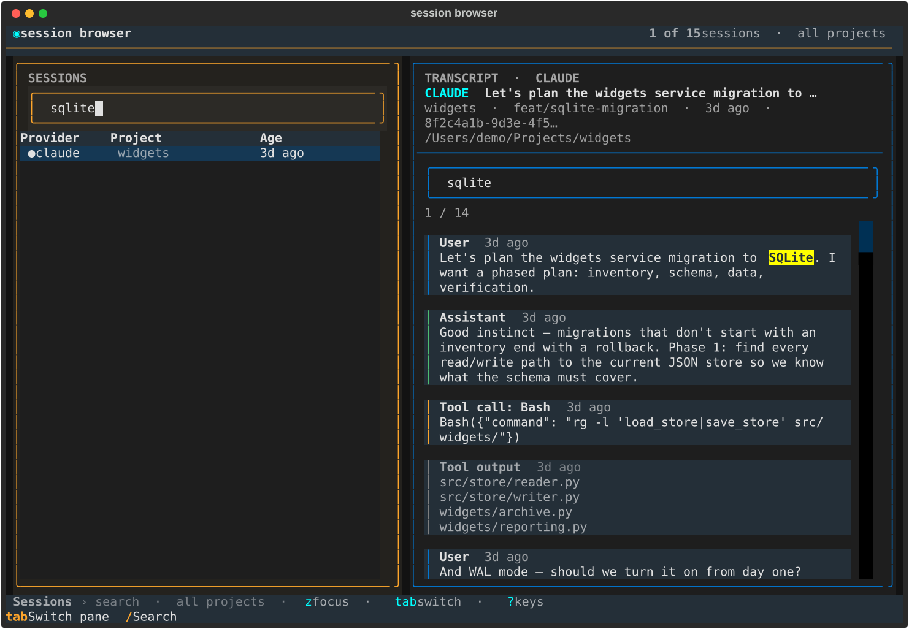
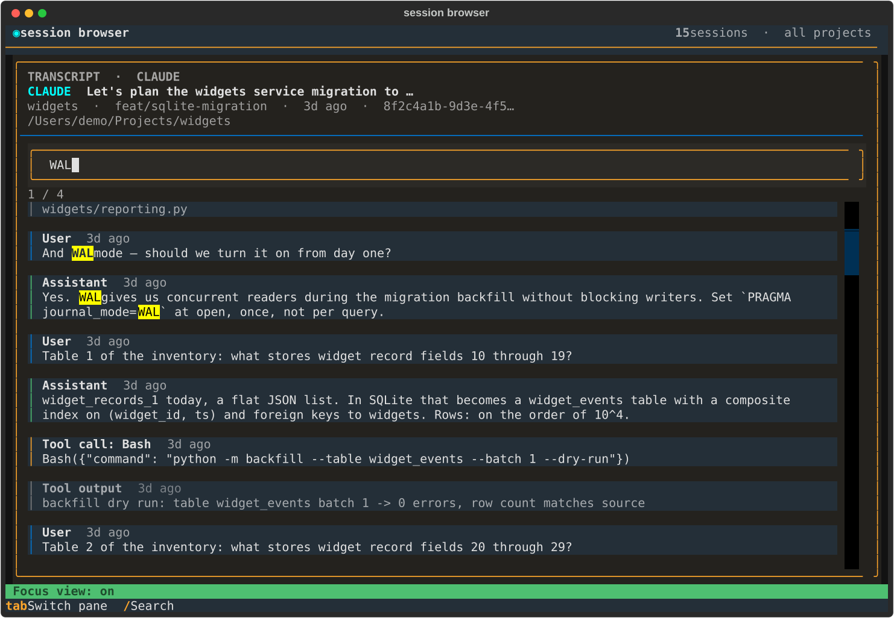

# session-browser

**Turn your agent transcripts into working memory.**

Claude Code, Codex, OpenCode, Pi and Grok all keep session histories. Session
Browser brings them together so you — or your agent — can find what an earlier
session decided, tried or got wrong, pick the work back up where it stopped,
build a handoff, and spot the patterns and pain points that keep coming back.



Every session adds decisions, investigations, fixes, and working patterns to an
evolving knowledge base. That knowledge is scattered across provider-specific
folders and databases. Session Browser makes it one browsable, searchable
memory: a terminal-native TUI for you and a rich retrieval surface for your
agents.

## Put old sessions back to work

- **Find where it happened.** The session where a decision was made, a bug was
  first seen, or "we did this before" — and why. Search complete Claude Code,
  Codex, OpenCode, Pi and Grok transcripts together from the TUI, or let your agent
  find the useful parts through the CLI.
- **Pick up where you left off.** Read how the last session ended and carry on,
  or continue the original session directly in tmux or Herdr, or copy the
  agent-specific resume command to the clipboard, all from the TUI. A session
  resumes in the permission mode it was started in, as its transcript records
  it (Claude Code's permission mode, Codex's approval and sandbox policies).
- **Let agents research your history.** The JSON-friendly CLI and bundled skill
  let an agent find and retrieve earlier work itself, without you pasting old
  conversations into a new chat — and it reaches for it unprompted: in seven
  weeks of use, most sessions that ran it had never been asked to.
- **Great for handoffs.** Pulls the relevant context from previous sessions so
  the next agent can pick up where you left off.
- **Find the patterns worth keeping.** Mine repeated fixes, decisions, and
  workflows across sessions, then turn the useful ones into reusable skills,
  prompts, or playbooks.
- **Stay in the terminal.** Browse, search, export, and resume sessions where
  your coding agents already run — no browser tab or separate desktop app
  required.
- **Keep your history local.** Session Browser reads the providers' native
  histories directly.
- **Light by design.** There is no daemon, embedding model, or separate
  database to set up and maintain. Install it, run it, and search the histories
  you already have. To stay fast it keeps a disposable cache of the text it
  parsed out of each transcript, about a thirteenth of the size of the history
  itself, which it builds and refreshes by itself (see [the search
  cache](#the-search-cache)).

## Ask your agent

With the bundled skill installed, requests like these can use your existing
session history as evidence:

> Find what we were working on in this repo at the end of last week. Give me a
> quick summary so we can pick it up.

> Look back over the last two weeks. Have we hit the same problems more than
> once? Suggest tooling or skills that would stop us reinventing the wheel.

> I lost the thread this afternoon. Review today's sessions and make me an
> explainer of what changed and why.

## Install and run

### With uv (recommended)

[uv](https://docs.astral.sh/uv/) is available for macOS, Linux, and Windows.
It installs Session Browser in an isolated environment, puts the command on
your path, and supplies a compatible Python version if you need one.

```bash
uv tool install git+https://github.com/steveoleary/session-browser.git
session-browser
```

Upgrade later with:

```bash
uv tool upgrade session-browser
```

### With pipx

If you already use [pipx](https://pipx.pypa.io/), install and upgrade directly
from the same Git repository:

```bash
pipx install git+https://github.com/steveoleary/session-browser.git
pipx upgrade session-browser
```

### From a clone

```bash
git clone https://github.com/steveoleary/session-browser.git
cd session-browser
uv tool install --editable .
session-browser
```

The editable install always runs the code in your checkout.

## See it in action

### Search across every session

Press `/` and search once across all five providers. The session list narrows
to the conversations that contain your phrase, while the transcript shows the
match in context. When you find the right one, press `t` to continue it in tmux
or Herdr, or `c` to copy its resume command — search, read, and resume without
leaving the UI.

You do not need the phrase. Type the few things you remember — `canary
rollback friday`, or `billing export timeout` — and when the exact phrase comes up
short the list fills with sessions where every word turns up: in what was said,
in any turn and any order, or in the project, summary or branch. A word said
fifty turns after the others still counts, so adding something else you
remember homes in on the session instead of losing it. Those rows are marked
`≈` and sit below exact matches, the ones where you typed the words yourself
first. Put the query in double quotes to ask for the phrase and nothing else.



### Read the part that matters

Press `z` to give the transcript the full terminal, then use `n` and `N` to move
between matches inside the conversation. On a long session, `m` collapses the
transcript to just the blocks that matched, marking how many it left out
between them; long tool calls and outputs stay folded to a preview of the match
until you open one with `Enter`.



The layout adapts to the available space: a wide two-pane browser on a large
terminal, a balanced view at medium sizes, and a full-width sessions/transcript
flow when space is tight.

## Command line

Running `session-browser` with no arguments opens the TUI. The same history is
available through four commands for agents, scripts, and targeted retrieval:

```bash
# Browse recent sessions from this project
session-browser list --here --limit 20

# Choose a session using short excerpts of its latest user and assistant messages
session-browser list --here --limit 6 --preview ending

# What was left half-done last week: no reply, stopped mid-tool-call, or cancelled
session-browser list --since -1w --ending unfinished

# Search complete transcripts and return useful context
session-browser search --here --mode snippets "pytest fixture"

# Retrieve a session by canonical id, raw id, or unique prefix
session-browser get claude:7645 --output handoff.md

# What a session was asked to do and where it got to, in one read
session-browser get claude:7645 --brief

# Read recent user and assistant messages together, sharing a text budget
session-browser get claude:7645 --recent 8 --budget 6000

# Summarise projects, providers, activity, and working directories
session-browser stats --here
```

### Ignoring noisy paths

Loop runs and dogfood worktrees can bury real history. List their paths in
`~/.config/session-browser/ignore` (or under `$XDG_CONFIG_HOME`), in gitignore
syntax, matched against each session's working directory:

```gitignore
# loop and dogfood runs: real work, little value as history
~/Projects/bloodhound-dogfood/
```

It works like ripgrep's ignore handling. Ignored sessions drop out of `list`,
`search`, `stats` and the TUI without comment, `--no-ignore` brings them back,
and a session named directly (`get ID`) is always read. The one time it speaks
is when a filter comes back empty and ignored sessions would have matched. In
the TUI, `.` shows or hides them and the header counts them. Turn that count off
in `~/.config/session-browser/config.toml`:

```toml
[tui]
ignored_notice = false
```

### How far back your history goes

Session Browser can only show what the providers still keep, and Claude Code
deletes its own transcripts. By default it removes any session older than 30
days, in a background sweep at startup that prints nothing, so a month-old
investigation simply stops appearing in `list` and `search`. Raise the limit in
`~/.claude/settings.json`:

```json
{
  "cleanupPeriodDays": 180
}
```

This only stops future deletions; a session the sweep already removed is gone.
Check how far back you reach with `session-browser stats --provider claude`,
whose first line gives the date range of what is still there. See Claude Code's
[`cleanupPeriodDays`](https://code.claude.com/docs/en/settings-reference#cleanupperioddays)
for what else the sweep removes.

Codex keeps its rollouts, and recent versions compress older ones to
`.jsonl.zst`. Session Browser reads one by decompressing it as it goes, once
per version of the file, into [the search cache](#the-search-cache), and keeps
no decompressed copy for that. A copy is made, in
`~/.cache/session-browser/zst` (or under `$XDG_CACHE_HOME`), only where a raw
scan needs a file on disk: with the search cache off, or for the few sessions
it cannot hold. A copy takes about five times the compressed size, one that
nothing has used for a day is cleared out, and the directory is safe to delete.

### The search cache

A provider's transcript is mostly not conversation: images, tool results stored
twice, file snapshots. On one machine 6.7 GB of transcripts held 0.5 GB of text
a search could ever match. So the first time Session Browser reads a session it
keeps the parsed text in `~/.cache/session-browser/entries` (or under
`$XDG_CACHE_HOME`), and from then on searches that instead of the original.
Beside it, `discovery` remembers what listing a session needs (its summary,
directory and last activity), so that listing does not reopen every transcript.

- The first search of a history parses all of it once, which takes about as
  long as one search used to. After that only sessions that changed are parsed
  again: on that machine a search that took four seconds takes a third of one,
  and one for a file name or a commit hash, which took fifteen, takes the same.
  With `--limit`, so does a word in nearly every session: the cached text says
  which sessions match before any of them is read, so only the rows shown are
  read -- unless `--role`, `--match-all` or `--sort matches` or `first-said`
  needs every match counted first.
- It is checked against each transcript's size and modification time on every
  read, and rebuilt after an upgrade changes how transcripts are parsed. It can
  be stale only by being slow, never by being wrong.
- It holds the text of your sessions, readable by you alone, like the
  transcripts it came from. Deleting a session from the TUI deletes its cached
  text too, and text cached from a transcript the provider has since removed
  is cleared out by the next day's first search.
- It is safe to delete, and `SESSION_BROWSER_CACHE=0` turns it off: every
  command then reads the providers' files directly, as it did before the cache
  existed.

Use `session-browser COMMAND --help` for filters, output formats, date ranges,
and retrieval windows. Commands return JSON by default where it is useful for
automation.

Ending previews and recent reads preserve entry numbers for expanding evidence.
The recent budget caps entry text per session; metadata and omission receipts are
additional. These are excerpts of the transcript, including progress messages,
not generated summaries or a claim that the session's work is complete.

## Skill for agents

The bundled `using-session-browser` skill lets Claude Code, Codex, OpenCode and
Pi recover earlier work themselves, assemble better handoffs, and mine recurring
knowledge from your session history.

Install it with the [skills CLI](https://skills.sh):

```bash
npx skills add steveoleary/session-browser@using-session-browser
```

Its source lives in
[`skills/using-session-browser/`](skills/using-session-browser/SKILL.md).

## Essential keys

Press `?` in the app for the complete key map.

| Key | Action |
|-----|--------|
| `/` | Search all sessions |
| `s` | Find within the selected session |
| `Tab`, `←` / `→` | Switch between sessions and transcript |
| `Enter`, `Esc` | Open a transcript / step back |
| `z` | Focus the active pane |
| `n` / `N` | Next / previous match |
| `m` | Show only the blocks that matched |
| `f` | Cycle the reading filter: conversation, your turns, agent turns |
| `space` | Expand or collapse a session's subagents |
| `T` | Nest subagents under their parent, or list everything flat |
| `c` | Copy a resume command |
| `i` | Copy the canonical session id |
| `e` / `E` | Copy / export the conversation |
| `D` | Delete the session permanently, after a confirmation naming what goes (every provider, OpenCode from 2.x; subagents go with their parent) |
| `p` | Toggle this-project scope (also clears a picked project) |
| `P` | Pick a project to scope to: type to filter, Enter to choose |
| `.` | Show or hide sessions your ignore file hides |
| `?` | Show all shortcuts |
| `q` | Quit |

A row can carry a mark before its summary: `▶` a running agent process still
holds the session (resuming or deleting it then asks first, or refuses),
`?` / `…` / `✗` its last turn was unanswered, stopped mid-tool-call, or
cancelled, and `↺` the summary is Claude Code's own recap rather than the
opening prompt.

## Development

```bash
uv sync
uv run pytest session_browser/ -q
uv run ruff check .
uv run ruff format --check .
```

The committed regression fixtures in `docs/fixtures/` can be checked with:

```bash
uv run python -m session_browser.case_runner run
```

## License

MIT — see [LICENSE](LICENSE).
